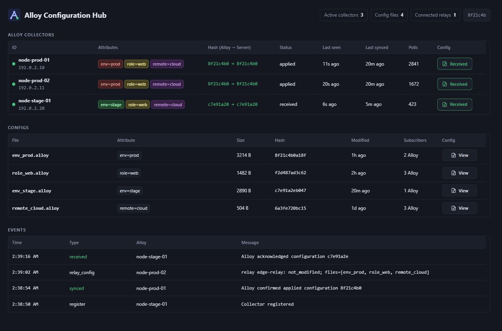

# Alloy Configuration Hub

> Работает через блок [`remotecfg`](https://grafana.com/docs/alloy/latest/reference/config-blocks/remotecfg/) Grafana Alloy и реализует [Alloy Remote Config API](https://github.com/grafana/alloy-remote-config): коллекторы сами запрашивают и применяют удалённую конфигурацию.

[English](README.en.md) · Русский

Сервер выдаёт Grafana Alloy конфигурации по атрибутам коллекторов, показывает их состояние и поддерживает ретрансляторы с локальным кешем. Интерфейс доступен только для чтения.



*Коллекторы, конфигурации, события и хеш текущего коммита. На скриншоте — демонстрационные данные.*

## Подключение конфигураций

Рекомендуется хранить `.alloy`-файлы в собственном отдельном Git-репозитории и самостоятельно подключать его рабочую копию к Hub. Конкретный репозиторий не требуется: укажите любой каталог через `CONFIG_SOURCE_DIR`. Можно использовать свободную папку `configs` или расположить конфиги отдельно от исходников приложения.

Например, клонируйте свой репозиторий рядом с приложением:

```bash
git clone <URL_ВАШЕГО_РЕПОЗИТОРИЯ> ../alloy-configs
```

Скопируйте `.env.example` в `.env` и задайте путь:

```dotenv
CONFIG_SOURCE_DIR=../alloy-configs
```

Hub читает `.alloy`-файлы в корне указанной папки. Подкаталоги не участвуют в объединении. Папка должна существовать до запуска и монтируется только для чтения. Git не обязателен: обычный каталог с файлами тоже подходит.

Если в папке есть `.git`, Hub читает текущий `HEAD` и выводит в шапке **только короткий хеш коммита**. Хеш ведёт на страницу коммита в репозитории из `remote.origin.url`; SSH-адрес преобразуется в веб-ссылку. Если подходящего remote нет, отображается хеш без ссылки. Без Git-метаданных элемент скрыт. Hub не запускает Git, не обращается к GitHub и не выполняет fetch/pull.

Поддерживаются каталог `.git`, файл `.git` со ссылкой `gitdir`, detached HEAD, упакованные refs и worktree. Для submodule/worktree целевая папка Git-метаданных может находиться вне каталога конфигов. В Docker она тоже должна быть доступна контейнеру: укажите её через `CONFIG_GIT_DIR`. Получить путь можно командой:

```bash
git -C ../alloy-configs rev-parse --absolute-git-dir
```

Для обычного клонированного репозитория `CONFIG_GIT_DIR` оставьте пустым — `.git` читается автоматически из `CONFIG_SOURCE_DIR`.

Профиль `alloy` дополнительно требует локальный bootstrap. Укажите его путь в `ALLOY_CONFIG_FILE`, например `../alloy-configs/collector/config.alloy`. Пример содержимого:

```alloy
remotecfg {
  url            = sys.env("ALLOY_CONFIG_URL")
  id             = constants.hostname
  poll_frequency = "30s"

  attributes = {
    name   = constants.hostname,
    env    = sys.env("ALLOY_ENV"),
    remote = sys.env("ALLOY_REMOTE"),
  }
}
```

Локальные `.alloy`-файлы в корне приложения, `.env`, секреты и каталог `data` игнорируются Git. Docker build context содержит только исходники Go и web; конфиги и Git-метаданные в образ не попадают.

## Один Compose, три профиля

Все варианты запуска находятся в `docker-compose.yml`. Профили включаются явно; без профиля команда `docker compose up` не выбирает сервисы.

| Вариант | Команда |
|---|---|
| Только Hub | `docker compose --profile hub up -d --build` |
| Hub и локальный Alloy | `docker compose --profile hub --profile alloy up -d --build` |
| Только ретранслятор | `docker compose --profile relay up -d --build` |
| Ретранслятор и Alloy | `docker compose --profile relay --profile alloy up -d --build` |
| Все три компонента | `docker compose --profile hub --profile relay --profile alloy up -d --build` |

Перед запуском ретранслятора задайте `UPSTREAM_URL`. Для Alloy, работающего через ретранслятор, задайте `ALLOY_CONFIG_URL=http://alloy_config_relay:8080`. Без этого Alloy обращается прямо к Hub. Если запускается только Alloy, задайте доступный ему адрес внешнего Hub или ретранслятора.

Скопируйте пример окружения, если нужно изменить параметры:

```bash
cp .env.example .env
```

PowerShell: `Copy-Item .env.example .env`. Значения в `.env.example` описывают локальную схему, в которой одновременно запущен Hub; при отдельном ретрансляторе замените адрес upstream.

Полная локальная цепочка в Bash:

```bash
UPSTREAM_URL=http://alloy_configuration_hub:8080 \
ALLOY_CONFIG_URL=http://alloy_config_relay:8080 \
docker compose --profile hub --profile relay --profile alloy up -d --build
```

Отдельный ретранслятор в PowerShell:

```powershell
$env:UPSTREAM_URL = "http://MAIN_HUB:8081"
docker compose --profile relay up -d --build
```

Порты по умолчанию: Hub — `8081`, ретранслятор — `8082`, Alloy — `12345`. Внутри сети Compose Hub и ретранслятор слушают `8080`. `host.docker.internal` обозначает Docker-хост, а не произвольный удалённый сервер.

Проверка, логи и остановка:

```bash
docker compose --profile hub --profile relay --profile alloy config --quiet
docker compose --profile hub logs -f alloy_configuration_hub
docker compose --profile relay logs -f alloy_config_relay
docker compose --profile hub --profile relay --profile alloy down
```

Остановка сохраняет `alloy_data` и `relay_cache`. Флаг `down -v` удаляет их. Не применяйте `--remove-orphans` без проверки других запущенных сервисов проекта. При переходе со старых Compose-файлов опубликованные порты и имена сервисов сохранены; сервис старого имени `alloy_conf_manager` нужно остановить перед запуском `alloy_configuration_hub`.

Профиль `alloy` предназначен для **Linux Docker host**: cAdvisor требует `privileged`, host PID/cgroup и доступа к системным каталогам. Docker Desktop позволяет наблюдать Linux VM, а не Windows/macOS хост. Hub и ретранслятор работают непривилегированными.

## Настройки

Полный пример — [.env.example](.env.example). Эти переменные используются одним Compose-файлом:

| Переменная | Значение по умолчанию / назначение |
|---|---|
| `HUB_PORT`, `HUB_BIND_ADDRESS` | `8081`, `0.0.0.0` |
| `CONFIG_SOURCE_DIR` | `./configs`, ваша папка с конфигурациями |
| `CONFIG_GIT_DIR` | Пусто: использовать `.git` из `CONFIG_SOURCE_DIR`; при необходимости — отдельный каталог Git-метаданных |
| `RELAY_PORT`, `RELAY_BIND_ADDRESS` | `8082`, `0.0.0.0` |
| `UPSTREAM_URL` | Обязателен для запущенного ретранслятора; для остальных профилей не нужен |
| `RELAY_NAME` | `config-relay`, имя в событиях Hub |
| `RELAY_TIMEOUT` | `5s`, таймаут upstream |
| `RELAY_CACHE_MAX_AGE` | `0s`: кеш не истекает; например, `24h` ограничивает офлайн-выдачу |
| `UPSTREAM_BEARER_TOKEN` | Необязательный токен ретранслятора для защищённого upstream |
| `ALLOY_ID` | `alloy-local`, hostname контейнера и ID коллектора |
| `ALLOY_PORT`, `ALLOY_BIND_ADDRESS` | `12345`, `0.0.0.0` |
| `ALLOY_CONFIG_FILE` | `./configs/collector/config.alloy` |
| `ALLOY_CONFIG_URL` | `http://alloy_configuration_hub:8080` |
| `ALLOY_ENV`, `ALLOY_REMOTE` | `prod`, `local`, атрибуты коллектора |

Для прямого запуска бинарника доступны `APP_MODE=server|relay`, `LISTEN_ADDR=:8080`, `CONFIG_DIR=/configs`, `CONFIG_REVISION_DIR` (по умолчанию `CONFIG_DIR`), `LOG_LEVEL=info`, `LOG_FORMAT=text|json`, `LOG_NOT_MODIFIED=true`. Ретранслятор использует `RELAY_CACHE_DIR=/var/lib/alloy-config-server/relay-cache`; этот путь сохранён для совместимости. Каталог должен быть доступен на запись UID 65532.

В Compose конфиги и метаданные монтируются только для чтения. Несуществующая папка приводит к ошибке запуска вместо создания пустого каталога; отсутствие `.git` внутри существующей папки не мешает работе Hub.

## Выбор и обновление конфигураций

Имя `<атрибут>_<значение>.alloy` задаёт селектор: `env_prod.alloy` соответствует `env=prod`. Первое подчёркивание разделяет имя атрибута и значение. Старый формат `<атрибут>=<значение>.alloy` тоже поддерживается. Общий файл с буквальным именем `*.alloy` применяется ко всем коллекторам; создание такого имени требует файловой системы, допускающей `*` (например, Linux).

Подходящие файлы объединяются внутри `declare "node_stack"` и вызываются через `node_stack "default"`. Общие файлы идут первыми, остальные — по имени. Подкаталоги не сканируются. Не выбирайте одновременно альтернативные шаблоны с одинаковыми именами компонентов.

Единственная серверная подстановка — `{{name}}`: значение атрибута `name`, затем атрибут `id` (если он не задан, добавляется ID коллектора). Значение экранируется для Alloy-строки. Имена файлов не вставляются в итоговый текст; подсветка блоков использует отдельные метаданные. Хеш считается от готового текста.

Hub проверяет имена и читаемость файлов; синтаксис проверяет Alloy при применении. После изменения файлы перечитываются с кешем в одну секунду. При ошибке чтения используется последняя читаемая версия, если она есть; файлы с неподходящими именами исключаются.

Конфиги обновляйте в собственном репозитории. Для обычной рабочей копии:

```bash
git -C ../alloy-configs pull --ff-only
```

Свои изменения сначала коммитьте и публикуйте в репозитории конфигов. Если вы сами выбрали submodule, отдельно обновляйте его ссылку в содержащем его репозитории. Hub автоматически перечитает доступные файлы, но не выполняет Git-операции и ничего в них не пишет.

## Интерфейс и API

В шапке показаны активные коллекторы, количество конфигурационных файлов и подключённых ретрансляторов. Активность — обращение за последние 5 минут; явно отключённый коллектор исключается сразу. Ретрансляторы различаются по имени и адресу; в цепочке виден ближайший к Hub.

Обновление интерфейса — каждые 3 секунды. Оно приостанавливается в скрытой вкладке, при выделении текста или открытом окне конфигурации. Части итогового конфига подсвечиваются по селекторам, имя файла доступно при наведении. Copy копирует чистый конфиг. В шапке отображается текущий хеш коммита папки конфигураций со ссылкой на него, если удалось определить remote.

`Sent` — конфигурация подготовлена к отправке; `Received` — подтверждён хеш либо применение; `Error` — Alloy сообщил ошибку для этой версии. Подсказка различает получение и применение. `Last synced` заполняется при подтверждении текущего хеша, `APPLIED` или свежем effective config с точно совпадающим содержимым. `FAILED` и `APPLYING` не подтверждают синхронизацию. Хеш получения хранится отдельно от `applied_hash`. Состояние хранится в памяти и сбрасывается при перезапуске.

| GET-маршрут | Назначение |
|---|---|
| `/` | Интерфейс Hub; в режиме relay — JSON-состояние |
| `/healthz` | Проверка процесса, без проверки upstream |
| `/api/state` | Коллекторы, конфиги, события, счётчики |
| `/api/config/{name}` | Исходный `.alloy`-файл |
| `/api/collector/{id}/config` | Последняя собранная конфигурация; `?format=json` добавляет метаданные блоков |
| `/api/collector/{id}/effective-config` | Последняя конфигурация, сообщённая Alloy; 404 до первого отчёта |
| `/api/relay` | Состояние отдельного ретранслятора |

Collector RPC (`GetConfig`, `RegisterCollector`, `UnregisterCollector`) работает через стандартный Alloy Remote Config API на том же порту. Запросы RPC не изменяют файлы.

## Ретранслятор и офлайн-режим

Ретранслятор передаёт конфиги, ID, атрибуты и отчёты состояния, а не метрики и логи. Адреса систем приёма телеметрии должны быть доступны самому Alloy.

Кеш изолирован по upstream, токену, ID и атрибутам. Файлы имеют хешированные имена и контрольную сумму. При временной недоступности upstream используется подходящий кеш с учётом `RELAY_CACHE_MAX_AGE`. При каждом опросе снова проверяется upstream. Ответы имеют `X-Config-Source: upstream|cache`.

`Unauthenticated`, `PermissionDenied` и `NotFound` не маскируются кешем и делают его недействительным. Редиректы upstream запрещены. Входящий Authorization не пересылается; ретранслятор использует собственный `UPSTREAM_BEARER_TOKEN`. Заголовки `X-Alloy-Relay-Name` и `X-Alloy-Relay-Hops` дают события `relay_config`; цепочка ограничена 8 переходами.

Неотправленные статус и effective config временно сохраняются в памяти и повторяются после восстановления связи. Отложенная регистрация повторяется, отключение не ставится в очередь. Перезапуск теряет эти отчёты, но сохраняет дисковый кеш. Кеш содержит последнюю полученную конфигурацию, а не обязательно последнюю успешно применённую.

## Безопасность

- Встроенной аутентификации и TLS нет. Порты по умолчанию слушают все интерфейсы. Ограничьте доступ сетью/файрволом либо используйте reverse proxy с TLS и аутентификацией; `*_BIND_ADDRESS=127.0.0.1` подходит для локального proxy.
- Клиентские ID, атрибуты и заголовки ретранслятора не являются доказательством личности. Без внешней защиты клиент может получить чужие конфиги; записи коллекторов и ретрансляторов в памяти не ограничены по общему количеству.
- RPC-запрос ограничен 16 MiB, HTTP-заголовки — 64 KiB. Эти лимиты не заменяют контроль доступа.
- Не храните ключи в `.alloy` и атрибутах. Используйте локальные секретные файлы и `local.file` с `is_secret = true`. Секреты, вписанные прямо в текст, видны в API, окне просмотра и кеше ретранслятора.
- Права доступа к приватному репозиторию не защищают работающий HTTP API. `.gitignore` не удаляет ранее закоммиченные секреты. В ссылку коммита не включаются логин, токен и query-параметры remote URL.

## Проверки разработки

Требуется Go 1.26 или новее:

```bash
go test ./...
go test -race ./...
go vet ./...
go run golang.org/x/vuln/cmd/govulncheck@latest ./...
docker build -t alloy-configuration-hub .
```

Версии зависимостей и контрольные суммы зафиксированы; Docker-сборка не запускает `go mod tidy`.

---

## 🚀 Быстрое знакомство

> [!TIP]
> **Здесь можно сразу попробовать Hub.** Нужны Docker с Compose и открытый терминал в каталоге проекта. Для первого запуска достаточно пустой папки — Git-репозиторий и Alloy можно подключить позже по инструкции выше.

**Bash · две команды:**

```bash
mkdir -p ../alloy-configs-demo
CONFIG_SOURCE_DIR=../alloy-configs-demo HUB_BIND_ADDRESS=127.0.0.1 docker compose --profile hub up -d --build
```

<details>
<summary><strong>Команды для PowerShell</strong></summary>

```powershell
New-Item -ItemType Directory -Path ../alloy-configs-demo -Force | Out-Null
$env:CONFIG_SOURCE_DIR = "../alloy-configs-demo"
$env:HUB_BIND_ADDRESS = "127.0.0.1"
docker compose --profile hub up -d --build
```

</details>

### Открыть → [http://localhost:8081](http://localhost:8081)

При первом запуске таблицы будут пустыми. Укажите свою папку с конфигами и подключите коллекторы, когда будете готовы.

Логи: `docker compose --profile hub logs -f alloy_configuration_hub`

Остановить: `docker compose --profile hub down`
